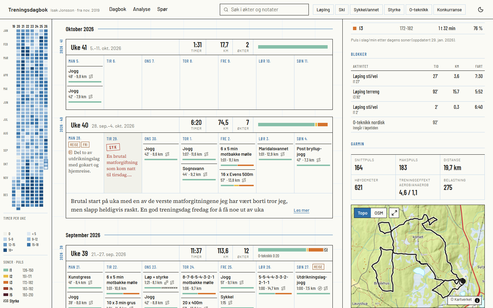
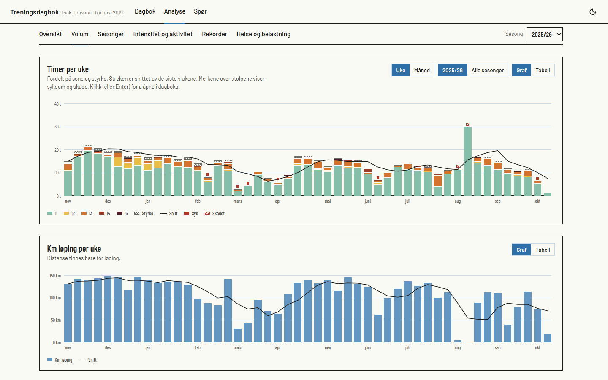
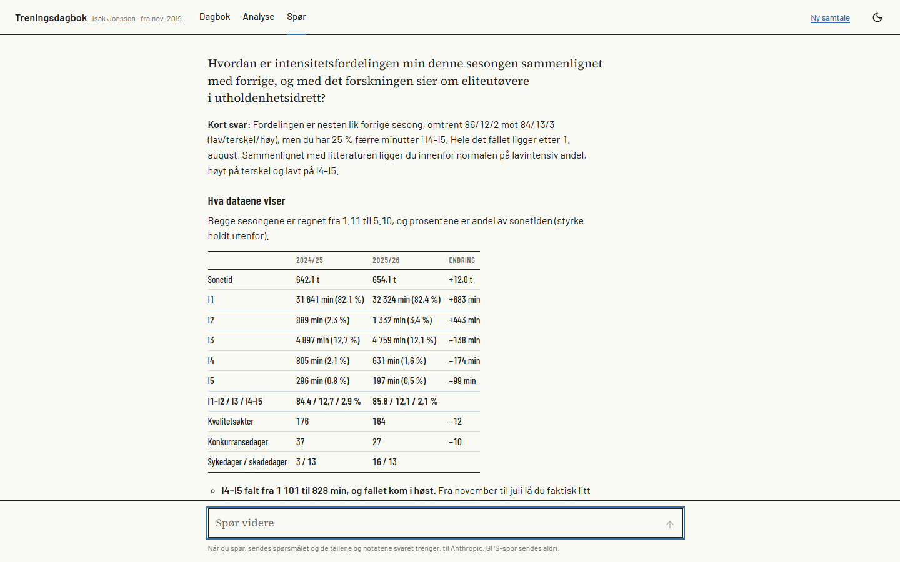

# Treningsdagbok

[](https://github.com/sotpoteten/treningsdagbok/actions/workflows/pages.yml)

En nettside som gjør Isak Jonssons treningsdagbok lesbar, søkbar og analyserbar: sju år
med orienteringstrening, rundt 3 900 økter. Dataene kommer fra dagboka til Olympiatoppen
(dagbok.olympiatoppen.no), fra 1. november 2019, og fra en full Garmin-eksport.

**Se den kjørende siden: [sotpoteten.github.io/treningsdagbok](https://sotpoteten.github.io/treningsdagbok/)**





## Teknikk

- **Nettsiden:** Vite, React og TypeScript, uten UI-bibliotek. Grafene er egne
  SVG-komponenter med d3, med tastaturstyring og tabellvisning. Kartet bruker MapLibre med
  Kartverkets topografiske kart.
- **Data:** Python-skript gjør eksportene om til ryddige JSON-filer. Garmin-skriptet
  dekoder rundt 5 900 FIT-filer parallelt og kobler aktivitetene til dagbokøktene.
- **Assistenten:** Claude Agent SDK med fem egne verktøy som regner tallene i kode, pluss
  nettsøk etter kilder.
- **Design:** Et eget designsystem, «Kartbladet», beskrevet i [`DESIGN.md`](DESIGN.md).
  Sonefargene er validert for fargeblindhet.
- **Tester:** vitest og Pythons unittest. Summene sjekkes mot kontrolltall fra dagboka.

Prosjektet er utviklet sammen med Claude Code. [`CLAUDE.md`](CLAUDE.md),
[`DESIGN.md`](DESIGN.md) og [`PRODUCT.md`](PRODUCT.md) er arbeidsdokumentene som styrer
det arbeidet.

## Innhold

- **Dagbok:** Ukeskalender med alle økter og soner, km og notater. Den har ukesummer,
  ukeskommentarer og dagsmarkører (syk, skadet, reise, høydedøgn, konkurranse) og en
  årsnavigasjon som viser treningsvolum per uke.
- **Øktpanel:** Blokker, soner, notat og Garmin-data. Garmin-dataene er kart med
  GPS-spor (Kartverket topo/OSM), puls- og tempokurve og runder.
- **Analyse:** Oversikt mot forrige sesong, volum over tid, sesongsammenligning,
  intensitet og aktivitet, rekorder, og helse og belastning (hvilepuls, HRV, søvn og
  Garmins treningsbelastning).
- **Spør:** En AI-assistent som svarer på spørsmål om treningen. Den henter tallene fra
  dagboka og ser dem opp mot treningslære og forskning, med lenker til kilder, uker og
  økter. Den virker bare når siden kjøres lokalt.

Siden er statisk (Vite, React og TypeScript) og leser JSON-filer. Bare «Spør» trenger
utviklingsserveren.
Treningsåret regnes fra 1. november til 31. oktober.

## Kom i gang

Krever Node.js (LTS) og Python 3.12.

```
cd web
npm install
npm run dev        # http://localhost:5180
```

`npm run dev` kopierer først dataene fra `data/` til `web/public/`. Andre kommandoer:

```
npm test           # vitest: summer mot kontrolltall, sesonger, søk, helseserier
npm run build      # typesjekk og bygg til web/dist/
```

## Spør (AI-assistenten)



Assistenten kjører i utviklingsserveren og starter sammen med `npm run dev`. Den bruker
Claude gjennom innloggingen fra Claude Code, så du må være innlogget der. Spørsmålene
teller mot bruksgrensene i Claude-abonnementet.

- **Hva den kan:** lese summer per uke, måned, sesong og år, søke i øktene, lese enkeltøkter
  med Garmin-runder, dager med helsedata og ukeskommentarene, og søke på nettet etter
  kilder. Den kan ikke lese filer, kjøre kommandoer eller endre noe.
- **Hva som sendes ut:** Spørsmålet og de tallene og notatene svaret trenger, sendes til
  Anthropic. GPS-spor sendes aldri.
- **Innstillinger** (valgfrie) i `web/.env.local`, som holdes utenfor git:
  - `ASSISTENT_MODELL`: en annen modell enn `claude-opus-5-5`
  - `ANTHROPIC_API_KEY`: bruk en API-nøkkel i stedet for abonnementet

## Oppdatere dataene

### Olympiatoppen-dagboka

1. Eksporter fra dagboka, og legg `workoutSessions.json`, `userData.json` og
   `weekComments.json` i `data/raw/`.
2. Kjør `python scripts/konverter.py`. Det lager `data/okter.json`, `dager.json`,
   `uker.json`, `profil.json` og `blokker.csv`. Skriptet varsler hvis det finner ukjente
   koder.

### Garmin

1. Be om full eksport fra Garmin-kontoen (Data Management → Export Your Data).
2. Kopier mappa `DI_CONNECT/` fra eksporten til `data/raw/garmin/`.
3. Sett opp Python-miljøet første gang:
   ```
   python -m venv .venv
   .venv\Scripts\pip install fitdecode tzdata
   ```
4. Kjør konverteringen:
   ```
   .venv\Scripts\python scripts/konverter_garmin.py
   ```
   Første kjøring dekoder rundt 5 900 FIT-filer og tar omtrent en time. Senere kjøringer
   bruker en buffer og går raskt.

Skriptet lager:
- `data/garmin_aktiviteter.json`: aktivitetene, koblet til dagbokøktene
- `data/garmin_helse.json`: hvilepuls, HRV, søvn og belastning per dag
- `data/garmin_spor/`: GPS-spor, bare lokalt

Det skriver også ut hvor stor andel av øktene som ble koblet. Ved forrige eksport var det
94 %.

## Struktur

```
data/                 ryddige data (kilden for nettsiden)
  raw/                rå eksporter – holdt utenfor git
  garmin_spor/        GPS-spor per aktivitet – holdt utenfor git
scripts/
  konverter.py        Olympiatoppen-eksport → data/*.json
  konverter_garmin.py Garmin-eksport → data/garmin_*.json og spor
  garmin_kobling.py   kobler Garmin-aktiviteter til dagbokøkter (+ test_garmin_kobling.py)
web/                  nettsiden (Vite + React + TypeScript)
  assistent/          «Spør»: Vite-tillegg, agent, systemprompt og dagbokverktøy
  src/data/           lasting, summer, sesonger, statistikk, søk
  src/komponenter/    kalender, øktpanel, grafer (graf/), kart (kart/)
  src/sider/          Dagbok, Analyse (analyse/) og Spør
  src/stil/           fargetokens og stiler
```

## Tester

```
cd web && npm test                                   # nettsiden
.venv\Scripts\python -m unittest scripts/test_garmin_kobling.py   # Garmin-koblingen
```

Testene sjekker at summene per år stemmer med kontrolltallene i `CLAUDE.md`, at sesonger og
ISO-uker regnes riktig, og at koblingen mot Garmin håndterer flere aktiviteter per økt.

## Personvern

Repoet er offentlig. Dagboknotatene, ukeskommentarene og helsedataene i `data/` ligger
åpent, og det har Isak valgt selv. To ting holdes utenfor git:
- **Rådataene** (`data/raw/`), fordi de inneholder blant annet e-post og fødselsdato.
- **GPS-sporene** (`data/garmin_spor/`), fordi de viser hvor Isak bor. Den publiserte
  siden har derfor ikke kart og kurver per økt. De vises når siden kjøres lokalt.

## Lisens

Koden er lisensiert under [MIT](LICENSE). Dataene i `data/` er personlige og omfattes
ikke av lisensen.

## Dokumentasjon

- [`CLAUDE.md`](CLAUDE.md): datamodell, koder, regler for beregninger, kontrolltall,
  Garmin-detaljer og oppbyggingen av nettsiden
- [`PRODUCT.md`](PRODUCT.md): hvem siden er for og hva den skal gjøre
- [`DESIGN.md`](DESIGN.md): designsystemet «Kartbladet» med farger, typografi,
  komponenter, diagrammer og kart
